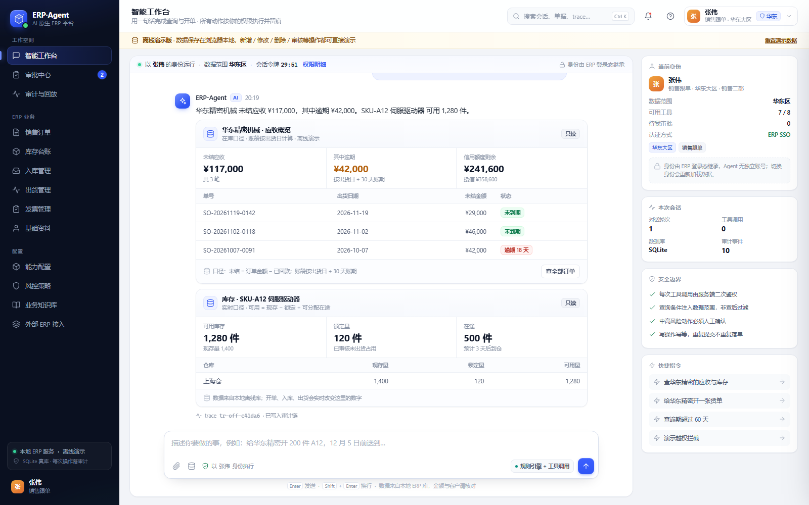
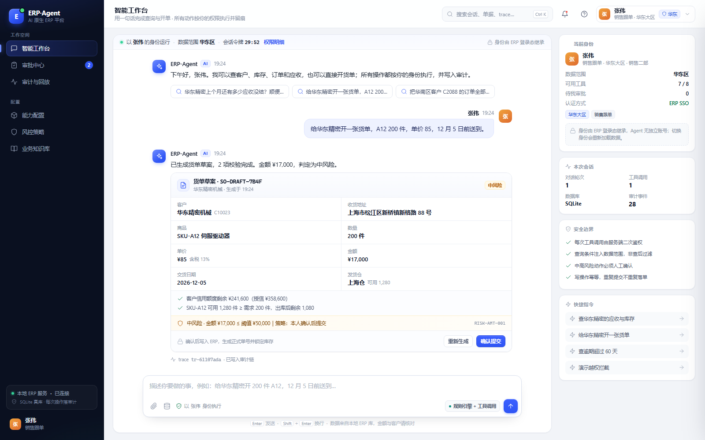
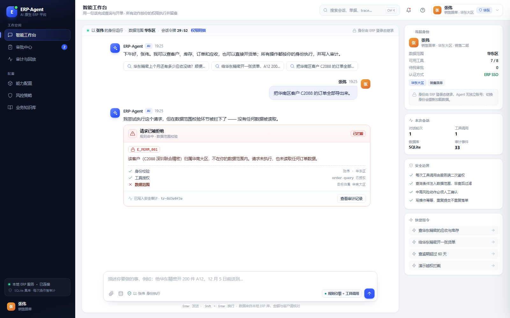
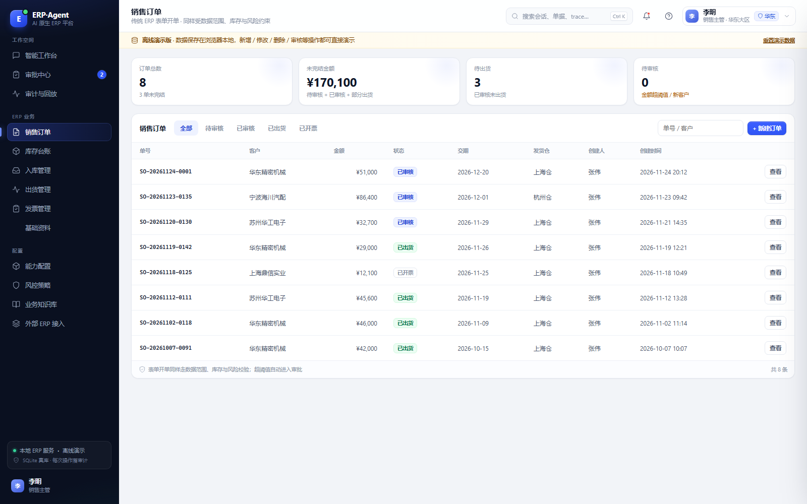
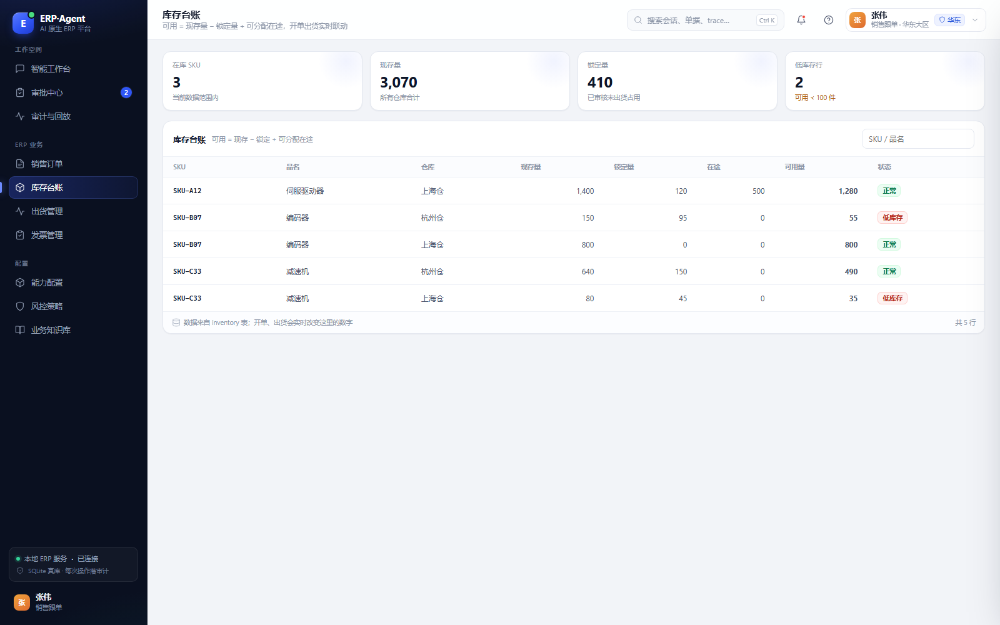
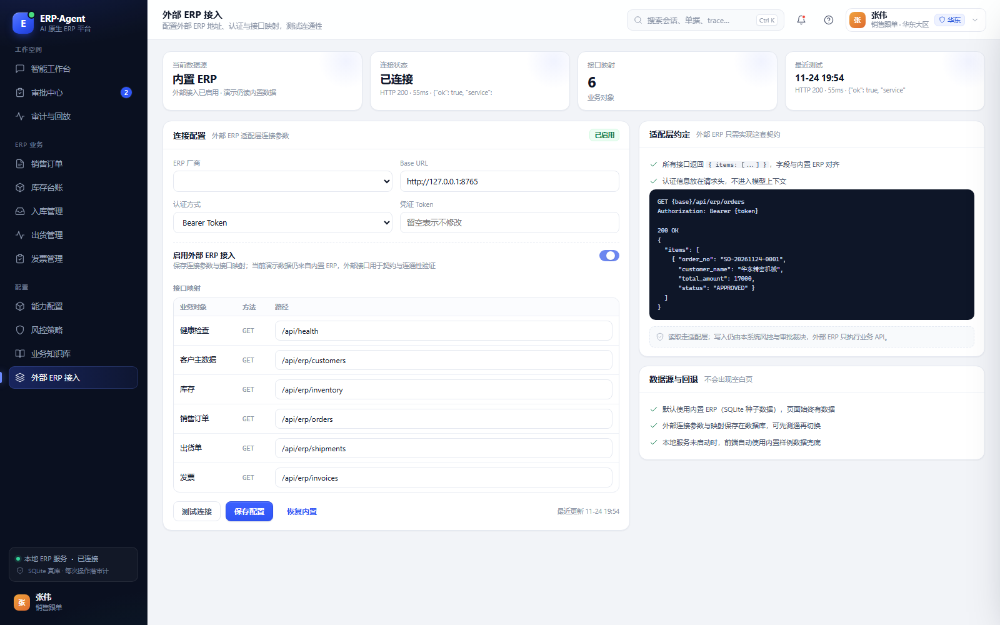

# AI 原生 ERP 智能体平台

> 传统 ERP 与 AI 智能体共用一套业务规则、权限与审计：对话查数、草案开单、风险拦截、审批、出货、开票、回放。
>
> **v2.0 · 离线可运行**：下载后直接双击 `prototype/index.html`，不需要服务、数据库或任何依赖。



## 这是什么

一个可交互的高保真原型 + 可运行 ERP 内核，用来验证“AI 原生 ERP”应该长什么样，而不是只画几张静态图。

- **传统 ERP**：销售订单、库存台账、入库、出货、发票、基础资料（客户/商品 CRUD）、审批中心；
- **AI 智能体**：自然语言查询应收/库存/订单、草案开单、风险分级、二次确认、越权拦截、审计回放；
- **同一套规则**：AI 开的单出现在销售订单里；传统页面开的单 AI 也能查到；权限、库存、状态机、审批完全一致；
- **离线完整演示**：所有写操作在浏览器 localStorage 中真实执行，刷新后保留，可一键重置。

## 快速开始

```bash
git clone https://github.com/qiancos/ai-native-erp-agent.git
cd ai-native-erp-agent
# 直接双击 prototype/index.html
```

不需要 `npm install`，不需要启动后端。页面顶部出现「离线演示版」即表示运行在本地数据模式。

可选的服务模式（SQLite 持久化 + 真实 HTTP 接口）：

```bash
python erp/server.py
# http://127.0.0.1:8765/
```

Python 3.10+，只用标准库，无第三方依赖。

### 演示账号

离线模式点右上角头像即可切换身份，无需密码；服务模式密码统一 `demo123`。

| 账号 | 角色 | 能验证什么 |
| --- | --- | --- |
| `zhangwei` | 销售跟单 | 开单、查客户、被数据范围拦截 |
| `liming` | 销售主管 | 审核订单、驳回、取消 |
| `wangqiang` | 仓储发货 | 入库、出货 |
| `chenjing` | 财务 | 开票 |
| `chenli` | 财务总监 | 发票审批 |
| `wangmin` | 风控管理员 | 规则、工具、全量数据 |

## 界面

| AI 工作台 | 草案开单 |
| --- | --- |
|  |  |

| 越权拦截 | 订单审核 |
| --- | --- |
|  |  |

| 传统 ERP · 库存 | 外部 ERP 接入 |
| --- | --- |
|  |  |

## 文档

| 文档 | Markdown | PDF |
| --- | --- | --- |
| 产品需求文档 PRD v2.0 | [PRD-v2.0.md](docs/AI原生ERP智能体平台-PRD-v2.0.md) | [PRD-v2.0.pdf](docs/AI原生ERP智能体平台-PRD-v2.0.pdf) |
| 技术开发方案 v2.0 | [开发方案-v2.0.md](docs/AI原生ERP智能体平台-开发方案-v2.0.md) | [开发方案-v2.0.pdf](docs/AI原生ERP智能体平台-开发方案-v2.0.pdf) |
| 开源框架选型建议 v1.0 | [选型建议.md](docs/开源框架选型建议.md) | [选型建议.pdf](docs/开源框架选型建议-v1.0.pdf) |

PDF 由 DOCX 导出，带封面、页眉页脚、页码、书签目录与文档元数据；DOCX 源文件在同目录，便于继续修改。

## 开源框架怎么选

**首选：RuoYi-Vue-Pro（芋道，MIT）+ Spring AI Alibaba / LangChain4j**。

- 40.6k stars，Java / Spring Boot 3 / Vue3，RBAC、数据权限、多租户、Flowable 工作流、ERP/CRM/MES 模块；
- MIT 许可证，商用与二次分发友好；
- 与国内企业技术栈、招聘和交付习惯匹配，后续需要规模化再拆 `yudao-cloud`。

**备选：ERPNext（GPL-3.0）+ LangGraph**，ERP 领域更完整，适合 Python 团队，但需评估 GPL 合规与实施资源。

详细的候选对比、许可证风险、目标架构和 8–12 周落地路线见 [开源框架选型建议](docs/开源框架选型建议.md)。

## 目录结构

```text
docs/                     PRD、开发方案、框架选型（MD / PDF / DOCX）
prototype/                可交互前端（双击 index.html）
  ├── index.html
  ├── app.js              路由、ERP 页面、离线业务引擎、AI 对话
  ├── styles.css
  ├── demo-data.js        离线种子数据
  └── screenshots/        高保真截图
erp/                      可选服务端：SQLite + HTTP + 审计链
tools/build_docs_v2.py    Markdown → DOCX（封面、页眉页脚、页码）
```

## 能验证的真实行为

| 行为 | 验证方式 |
| --- | --- |
| 库存真扣 | 开单/出货后库存台账的现存、锁定、可用同步变化 |
| 单号真生成 | 订单 `SO-…`、出货 `SH-…`、发票 `INV-…`、入库 `IN-…` |
| 越权真拦 | 查/开华南客户 `C2088` → `E_PERM_001` |
| 审批真路由 | 大额订单进入李明待办；张伟不能批自己的单 |
| 状态机真校验 | 未审核不能出货，未出货不能开票 |
| 审计真回放 | 每条事件带前序哈希，回放时逐条校验 |

## 说明

- 所有客户、单据、金额、人员均为虚构演示数据；
- 离线模式的 AI 为本地规则引擎（与后端同一套意图），不调用大模型；模型接入点已在开发方案中预留；
- 这是演示级原型与 ERP 内核，不含税务、总账、生产制造、多租户与并发压测；
- v1.0 文档与旧版原型已被 v2.0 取代，本仓库只保留 v2.0。
