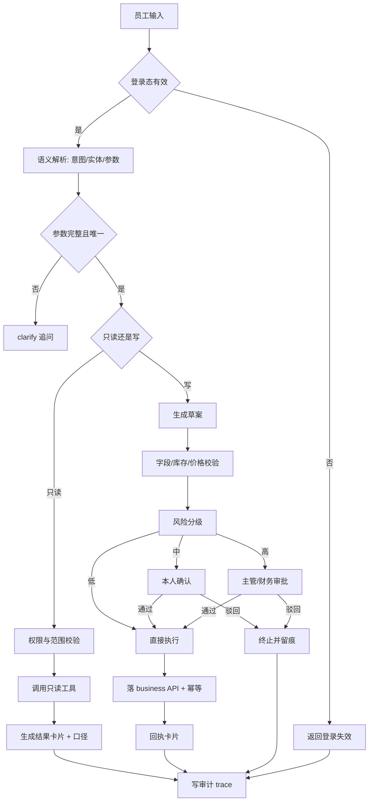
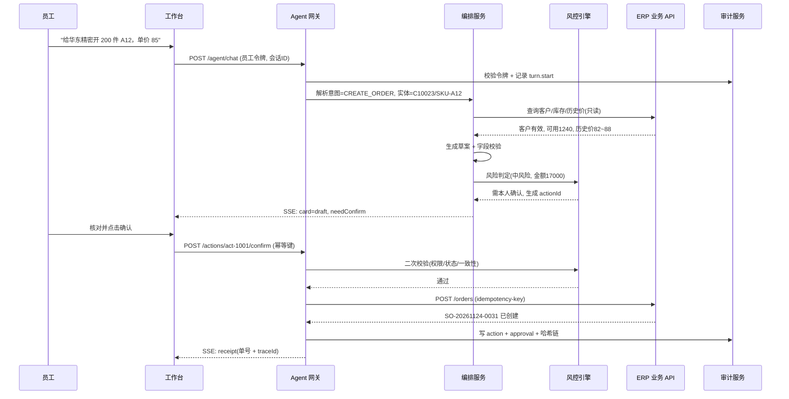
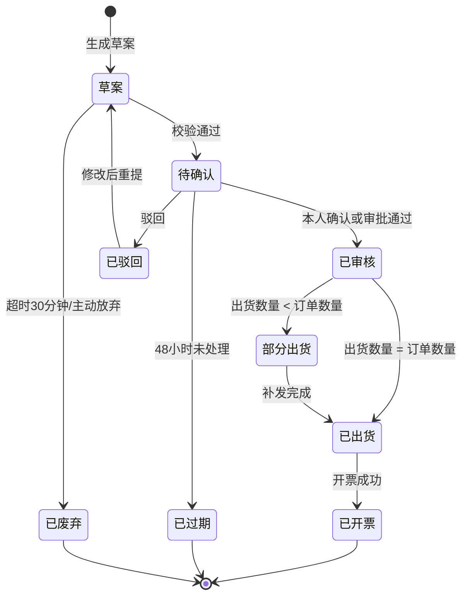

# AI 原生 ERP 智能体平台 产品需求文档（PRD）

| 项目 | 内容 |
| --- | --- |
| 文档名称 | AI 原生 ERP 智能体平台 产品需求文档（PRD） |
| 文档版本 | V2.0（V1.0 修订版） |
| 文档状态 | 评审稿（待业务与研发会签） |
| 编写日期 | 2026-11-24 |
| 产品代号 | ERP-Agent（AI-Native ERP Agent Platform） |
| 业务场景 | 中小企业进销存 / ERP 业务的对话式查询、单据操作与风控留痕 |
| 目标读者 | 产品、研发、测试、业务负责人、信息安全 |

## 修订记录

| 版本 | 日期 | 修订人 | 修订说明 |
| --- | --- | --- | --- |
| V1.0 | 2026-11-24 | 产品组 | 首版：完成需求分析、功能流程、风控规则与开发范围定义 |
| V2.0 | 2026-11-24 | 产品组 | 定位重构、范围收敛、交互规格化、接口/状态机/错误码补齐、验收与指标可执行化 |

## V2.0 相比 V1.0 的 8 项优化

| 编号 | 优化项 | 解决的问题 | 改动位置 |
| --- | --- | --- | --- |
| O1 | 增加"AI 原生"判定标准与形态对比 | V1.0 只能说明"要做什么"，无法回答"凭什么算 AI 原生、和加个聊天框有何区别" | 第 1 章 |
| O2 | 范围从 9 个模块收敛为 3 个闭环，开票工具灰度 | V1.0 功能面铺得宽，10 周内难以全部达到可验收质量 | 第 3 章、12 章 |
| O3 | 补齐对话消息类型与卡片字段级规格 | V1.0 只写"结果卡片/草案卡片"，前端无法据此开发 | 5.2 节 |
| O4 | 风险分级改为"默认等级 + 升级条件 + 规则版本"三要素 | V1.0 只给了一张示例表，规则如何配置、如何生效未定义 | 5.7 节、第 7 章 |
| O5 | 新增统一错误码表与用户可见话术 | V1.0 只有 FORBIDDEN 一个示例，拦截体验无法统一 | 7.3 节 |
| O6 | 对话接口由同步返回改为 SSE 事件流 | 8 秒内无反馈会导致用户重复提交，且无法展示工具执行过程 | 7.1 节 |
| O7 | 指标增加基线、公式与采集事件 | V1.0 指标只有目标值，无法验证是否达成 | 第 10 章 |
| O8 | 新增 12 条 Given/When/Then 验收用例与风控红线 | V1.0 验收标准是描述性的，测试无法直接转用例 | 第 11 章 |

## 目录

1. 产品定位：什么叫"AI 原生"
2. 问题、用户与目标
3. 范围与版本策略
4. 概念模型与能力分层
5. 功能规格
6. 核心流程与状态机
7. 接口契约
8. 数据模型
9. 非功能需求
10. 指标体系与埋点
11. 验收标准
12. 里程碑与灰度计划
13. 风险登记册
14. 附录

---

## 1. 产品定位：什么叫"AI 原生"

### 1.1 一句话定位

> 让 AI 以员工的身份进入 ERP 干活：能查、能算、能开单，但每一步都在权限、流程与审计之内。

产品不是"在 ERP 旁边加一个聊天框"，而是把 ERP 的业务能力重新组织成 **可被智能体安全调用的能力层**。员工用自然语言下达业务意图，系统把它翻译成受控的工具调用，走完校验、确认、执行、留痕的完整闭环。

### 1.2 三种形态对比

| 维度 | 传统 ERP | ERP + 聊天机器人（常见做法） | AI 原生（本产品） |
| --- | --- | --- | --- |
| 入口 | 菜单 + 表单 | 侧边浮窗，问答为主 | 工作台即对话，对话即操作 |
| 身份 | 员工账号 | 机器人独立账号或共享 API Key | 会话继承员工身份，**无 AI 专属账号** |
| 数据 | 页面查询 | 同步副本 / 宽表，口径易漂移 | 语义层直连业务 API，**口径唯一** |
| 操作 | 人工逐单录入 | 只能回答，落不了单 | 工具调用写业务 API，**草案可核对** |
| 约束 | 审批流 + 权限 | 靠提示词"请不要越权" | 服务端风控引擎，**fail-closed** |
| 协作 | 人找人 | 单轮问答 | 多步任务链 + 人工介入 + 全程回放 |
| 失败处理 | 人工撤销 | 无 | 幂等 + 补偿 + 可回滚 |

### 1.3 "AI 原生"的六条判定标准

以下六条是本期设计的硬约束，也是后续新增能力的准入条件。任何一条不满足，功能不得上线。

| 编号 | 标准 | 判定方式 | 对应设计 |
| --- | --- | --- | --- |
| N1 | 身份原生 | Agent 无独立账号，每次调用携带员工身份并由服务端二次鉴权 | F2、9.1 |
| N2 | 语义原生 | 业务口径（可用库存、账龄、含税金额）配置在语义层，不由模型即兴定义 | F4、5.5 |
| N3 | 操作原生 | 能力以工具契约注册，输入输出有 Schema；不使用 RPA 点页面、不让模型拼 SQL | F5、7.2 |
| N4 | 约束原生 | 越权、绕流程、直改库在后端拦截，不依赖提示词与模型自觉 | F6、5.7 |
| N5 | 追溯原生 | 每个动作有 traceId、参数、结果、确认人与哈希链，可回放 | F8、8.7 |
| N6 | 组织原生 | 任务可拆分、可暂停、可交接给人，失败不产生半成品单据 | F7、6.4 |

### 1.4 设计原则

1. **模型只做翻译，不做裁决**：模型负责把自然语言翻译成意图与参数，是否允许执行由服务端规则决定。
2. **默认拒绝**：工具未注册、权限未授予、状态不满足，一律拒绝并给出人话解释。
3. **先给草案，再落单据**：所有写操作先生成可编辑草案，人确认后才调用业务 API。
4. **澄清优于猜测**：参数缺失或多义时必须追问，不允许"合理推测"客户或金额。
5. **拒绝要说人话**：拦截提示必须包含"发生了什么、为什么、怎么办"，不暴露内部实现。
6. **窄而闭环**：宁可三个场景做到 100% 可信，不做十个场景都只有 60 分。

---

## 2. 问题、用户与目标

### 2.1 用户与待办任务（JTBD）

| 角色 | 典型一天 | 待办任务（JTBD） | 当前代价 |
| --- | --- | --- | --- |
| 销售跟单 | 接单、查库存、报价、催货 | 客户问"还有多少货、什么时候能发"时，30 秒内给准确答复 | 切 4 个页面，问仓库微信，平均 6 分钟 |
| 仓储发货员 | 备货、扫码、登记出库 | 拿到货单后确认可发数量并完成出库 | 手工核对，错发漏发靠人盯 |
| 财务开票员 | 对账、开票、催收 | 核对出货与开票信息，避免错开重开 | 跨系统核对，红冲成本高 |
| 销售主管 | 审批、看团队执行 | 判断一笔异常单据该不该批 | 只看到结果，看不到依据 |
| 系统管理员 | 配权限、配规则 | 新增一个业务能力并安全开放给 AI | 每次都要改代码发版 |
| 审计/合规 | 抽查、复盘 | 还原某个动作是谁在什么依据下做的 | 日志分散，无法串联 |

### 2.2 目标与非目标

**本期目标（V1.0）**

1. 查询类问题在 8 秒内给出带口径与来源的答案，替代 70% 的跨页面查询；
2. 标准货单从"说一句话"到"落单成功"在 3 分钟内完成，比手工录入省 30% 以上时间；
3. 写操作 100% 经过风险分级与人工确认，越权/绕流程/直改库 0 放行；
4. 任意一次 Agent 动作都能在 1 分钟内被完整回放；
5. 新增一个业务工具只需注册契约与权限，不改编排核心。

**明确不做**

- 不做脱离员工的 AI 超级账号，不做匿名入口；
- 不做模型直连数据库、直出 SQL、直改业务表；
- 不做自动授信、自动定价、自动结账等无人工的资金决策；
- 不做生产制造、MRP、多组织合并报表；
- 不替代客户现有 ERP 的表单与审批流；本演示环境内置一套传统 ERP 作为宿主，Agent 与人工表单是并列入口。

### 2.3 北极星指标

> **每周被采纳的 Agent 动作数（Accepted Actions / Week）**
> 定义：员工确认或直接执行、且未在 24 小时内被撤销/红冲的 Agent 动作条数。

选它的原因：既约束"AI 要真的干活"（不是聊天次数），也约束"干得对"（撤销即不计入），避免用调用量自欺。

---

## 3. 范围与版本策略

### 3.1 三个闭环（V1.0 全部范围）

| 闭环 | 覆盖场景 | 交付判定 | 对应模块 |
| --- | --- | --- | --- |
| 查询闭环 | 客户、库存、订单、应收四类只读查询 | 问一句 → 带口径卡片 → 可下钻 → 留痕 | F1/F3/F4/F8 |
| 制单闭环 | 创建货单、出货登记、（灰度）开票 | 说一句 → 草案 → 校验 → 确认 → 落单 → 回执 | F1/F5/F6/F8 |
| 审计闭环 | 动作检索、链路回放、拦截记录 | 任意 trace 可在 1 分钟内还原全流程 | F8/F9 |

**为什么收敛**：V1.0 原范围含 9 个模块、3 个写工具、多步编排与完整后台。按 10 周 2 人投入测算，若全部铺开，每个模块只能到"演示可用"，无法通过风控与审计验收。本版把"知识库、任务链、指标看板"降为 P1/P2，把资源集中到三个闭环的**可信度**上。

**宿主系统**：演示环境内置传统 ERP 模块（销售订单、库存台账、入库、出货、发票），人工按表单操作；智能体与传统页面共用同一套数据、权限与风控，任一侧产生的动作都进入同一审计链。

### 3.2 版本节奏

| 版本 | 内容 | 判定 |
| --- | --- | --- |
| V1.0（本期） | 查询闭环 + 制单闭环 + 审计闭环；开票工具默认关闭（feature flag） | 三个闭环全链路可演示、可验收 |
| V1.1（+4 周） | 开票灰度开放、退货/调拨工具、知识库运营、任务链模板 | 高风险场景审批覆盖率 100% |
| V1.2（+8 周） | 移动端审批、IM 待办、采纳率看板、多模型路由 | 一线周活与采纳率达标 |
| V2.0（半年） | 多组织/多币种、报表解读、供应链协同 | 单组织验证跑通后复制 |

### 3.3 范围矩阵（MoSCoW）

| 能力 | 优先级 | 本期 | 说明 |
| --- | --- | --- | --- |
| 对话查询（客户/库存/订单/应收） | Must | ✅ | 四类只读工具 + 语义口径 |
| 身份继承与二次鉴权 | Must | ✅ | 无独立账号，服务端校验 |
| 货单草案 + 确认落单 | Must | ✅ | 含字段校验与编辑 |
| 出货登记 | Must | ✅ | 状态机前置校验 |
| 风险分级 + 本人确认 | Must | ✅ | 中风险闭环 |
| 高风险审批 | Must | ✅ | 主管/财务审批中心 |
| 越权/绕流程/直改库拦截 | Must | ✅ | fail-closed |
| 审计留痕 + 链路回放 | Must | ✅ | 含哈希链校验 |
| 开票工具 | Should | ⏸ 灰度 | 默认关闭，财务角色白名单开启 |
| 知识库 RAG | Should | ◐ 雏形 | 术语与口径 50 条，先保准确率 |
| 管理后台（工具/规则/审计） | Should | ◐ 基础版 | 只做查看与开关，不做复杂编排 |
| 多步任务链 | Could | ✗ | V1.1 |
| 移动端/IM 审批 | Could | ✗ | V1.2 |
| 指标看板 | Could | ✗ | 先落埋点，后做看板 |
| 多组织/多币种 | Won't | ✗ | V2.0 |

---

## 4. 概念模型与能力分层

### 4.1 五层能力模型

V1.0 的"五可"是价值主张，本版把它落成可建设的五层，每层都有明确的输入输出与验收物。

| 层 | 名称 | 解决什么 | 关键产物 | 失败表现 |
| --- | --- | --- | --- | --- |
| L1 | 接入层 | 员工从哪里用、以什么身份用 | 会话工作台、身份上下文 | 身份错位、串号 |
| L2 | 语义层 | 业务词如何变成可执行查询 | 指标/维度/口径定义、实体映射 | 答非所问、口径漂移 |
| L3 | 能力层 | 能对外做什么动作 | 工具契约（Schema + 风险 + 权限） | 参数错、动作错 |
| L4 | 约束层 | 什么能做、什么必须问人 | 风险规则、拦截器、审批流 | 越权、绕流程、错单 |
| L5 | 证据层 | 做过的每件事如何证明 | trace、审计日志、回放视图 | 无法追责、无法复盘 |

### 4.2 领域对象

| 对象 | 说明 | 关键字段 | 生命周期 |
| --- | --- | --- | --- |
| Session 会话 | 一次连续的人机协作 | 员工、角色、数据范围、开始时间 | 进行中 → 结束/超时 |
| Turn 轮次 | 一次用户输入及其响应 | 输入、意图、置信度 | 单次 |
| Action 动作 | 一次工具调用的意图与结果 | 工具、参数、风险、状态 | 待确认 → 执行中 → 成功/失败/拦截 |
| Draft 草案 | 可编辑的单据草稿 | 业务字段、校验结果、版本 | 草稿 → 已提交/已废弃 |
| Approval 审批 | 高风险动作的人工决策 | 审批人、结论、意见 | 待批 → 通过/驳回/超时 |
| Trace 链路 | 跨服务的一次完整执行证据 | traceId、节点、耗时、哈希 | 追加写，不可改 |
| Tool 工具 | 注册的业务能力 | 名称、Schema、风险、权限 | 启停/版本 |
| Rule 规则 | 风险与拦截的判定逻辑 | 条件、等级、策略、版本 | 生效/失效 |

### 4.3 权限模型：三维授权

Agent 能否执行某动作，由三个维度同时决定，缺一即拒绝：

```
允许 = 角色权限(RBAC) ∩ 数据范围(Scope) ∩ 工具授权(Tool Grant)
```

| 维度 | 来源 | 示例 | 校验点 |
| --- | --- | --- | --- |
| 角色权限 | ERP 既有 RBAC | 销售跟单可创建货单，不可开票 | 网关 + 工具执行前 |
| 数据范围 | 组织/部门/客户归属 | 华东大区只能看华东 12 家客户 | 查询条件注入 + 结果过滤 |
| 工具授权 | Agent 侧工具白名单 | 开票工具仅财务角色可见 | 编排层 + 服务端二次校验 |

**关键约束**：三维判断全部在服务端完成；模型返回的"我有权限"不构成任何依据。

---

## 5. 功能规格

### 5.1 信息架构

```
ERP-Agent
├── 工作台（默认）
│   ├── 会话列表 / 新建会话
│   ├── 对话区（消息流 + 卡片）
│   └── 上下文栏（身份、数据范围、可用工具、会话统计）
├── 审批中心
│   ├── 待我审批（红点计数）
│   ├── 我发起的
│   └── 审批详情（字段 + 依据 + 轨迹）
├── 审计与回放
│   ├── 动作检索
│   ├── 链路详情（时间轴 + 哈希校验）
│   └── 拦截记录
└── 管理后台
    ├── 工具注册表
    ├── 风控策略
    ├── 知识库
    └── 成员与授权
```

### 5.2 F1 对话工作台

**目标**：让员工用一句业务话完成查询或开单，且随时知道"AI 以谁的身份、做了什么、依据是什么"。

**页面结构**

| 区域 | 内容 | 交互要点 |
| --- | --- | --- |
| 顶部身份条 | 姓名、角色、数据范围、会话令牌剩余时间 | 常驻可见；点击可查看权限明细，不可在此提权 |
| 消息流 | 用户消息、Agent 回复、卡片 | 自动滚动到底；上滑加载历史；支持复制与引用 |
| 执行轨迹 | 折叠的工具调用链 | 默认折叠，展开显示步骤、耗时、参数摘要 |
| 输入区 | 多行输入、发送、快捷指令 | Enter 发送 / Shift+Enter 换行；发送后禁止重复提交 |
| 上下文栏 | 身份卡、可用工具、会话统计、安全边界 | 桌面端常驻，窄屏收起为抽屉 |

**消息类型（前端必须实现的 9 种）**

| 类型 | 触发场景 | 结构 | 可交互 |
| --- | --- | --- | --- |
| text | 普通回复、解释 | 文本 + 来源角标 | 复制、追问 |
| clarify | 参数缺失或存在多义 | 问题 + 2~4 个选项 + 自由输入 | 点选即发送 |
| query_result | 只读查询完成 | 指标条 + 表格 + 口径脚注 | 导出、下钻、继续问 |
| draft | 写操作草案 | 字段网格 + 校验清单 + 风险条 | 编辑、重生成、确认 |
| approval | 高风险待审批 | 摘要 + 依据 + 审批人 | 提交审批、查看规则 |
| blocked | 越权/绕流程/直改库 | 拦截码 + 原因 + 依据 + 建议 | 申诉、查看规则 |
| receipt | 执行成功 | 单号 + 关键字段 + 轨迹入口 | 查看单据、回放 |
| progress | 长任务执行中 | 步骤条 + 当前节点 + 取消 | 取消 |
| error | 系统/模型异常 | 错误码 + 人话 + 重试 | 重试、转人工 |

**卡片字段规格：query_result**

| 区块 | 内容 | 规则 |
| --- | --- | --- |
| 标题 | 查询对象 + 时间范围 | 例："华东精密 · 近 90 天应收" |
| 指标条 | 2~4 个关键数字 | 金额带币种，数量带单位，右对齐，等宽数字 |
| 明细表 | ≤8 行，超出折叠 | 行可点击下钻；空结果显示空态文案 |
| 口径脚注 | 指标定义 + 数据时间 | 例："账龄按出货日计算；数据截至 18:20" |
| 操作 | 导出、继续追问 | 导出受数据范围与权限约束 |

**卡片字段规格：draft（货单）**

| 字段 | 来源 | 可编辑 | 校验 |
| --- | --- | --- | --- |
| 客户 | 语义实体匹配 | 是（搜索选择） | 必须存在且在数据范围内 |
| 联系人/收货地址 | 客户主数据 | 是 | 缺省取默认地址并提示 |
| 商品 SKU | 实体匹配 | 是 | 必须存在、启用、可售 |
| 数量 | 用户输入 | 是 | >0，且 ≤ 可用库存（可配置为警告） |
| 单价 | 用户输入 / 最近成交价 | 是 | 偏离历史区间 ±15% 时提示复核 |
| 金额 | 计算 | 否 | 数量 × 单价，含税口径明确 |
| 交期 | 用户输入 | 是 | 不早于今天 + 备货周期 |
| 发货仓 | 库存所在仓 | 是 | 必须有可用库存 |
| 备注 | 用户输入 | 是 | ≤200 字 |

**状态与异常**

- 空态：欢迎语 + 3 个示例问题 + 可用能力说明；
- 加载：首 token ≤1.5s，超过 3s 显示"正在检索业务数据"；
- 失败：给出错误码、人话解释与重试按钮，不吞错误；
- 拦截：红色卡片，说明"哪条规则、哪一步、如何申请"，并附 traceId；
- 重复提交：发送后按钮进入 loading 且禁用，服务端按 idempotency-key 去重。

### 5.3 F2 身份与权限继承

| 规则 | 要求 | 验收方式 |
| --- | --- | --- |
| 身份绑定 | 会话创建时从 ERP 登录态解析员工、角色、部门、数据范围 | 断开会话后令牌失效 |
| 无独立账号 | Agent 不持有可复用的高权限账号 | 全局检索无 agent 专用账号 |
| 凭证托管 | 短期令牌由服务端签发，前端与模型侧不可见长期密钥 | 抓包与前端源码检查 |
| 二次鉴权 | 每次工具调用独立鉴权，不缓存 Agent 层结论 | 越权用例 100% 拒绝 |
| 身份切换 | 切换员工需重新登录，会话不跨身份复用 | 切换后历史不可见 |
| 权限可见 | 上下文栏展示当前数据范围与可用工具 | UI 检查 |

### 5.4 F3 可读：业务数据查询与分析

**覆盖数据域（V1.0）**

| 数据域 | 可查内容 | 口径要点 | 典型问法 |
| --- | --- | --- | --- |
| 客户 | 基本信息、联系人、归属、信用额度、最近订单 | 信用额度 = 授信 − 未结应收 | "华东精密还欠我们多少" |
| 库存 | 现存量、锁定量、可用量、在途、库位 | 可用 = 现存 − 锁定 + 可分配在途 | "A12 现在能发多少" |
| 订单 | 状态、明细、金额、出货进度 | 金额含税，按订单币种 | "上个月华东的订单发完了吗" |
| 应收 | 余额、账龄、逾期 | 账龄按出货日起算，30/60/90 分档 | "哪些客户逾期超过 60 天" |

**规则**

- 只读工具不提供任何写入口，参数中不允许出现表名、字段名、SQL 片段；
- 数据范围在服务端注入查询条件，而不是查完再过滤（防止计数泄露）；
- 每个结果必须带口径与数据时间，口径来自语义层而非模型生成；
- 超过 8 行的结果分页或折叠，导出需二次权限校验；
- 金额字段标明币种与含税口径，比例字段标明分母。

### 5.5 F4 可理解：业务语义与知识库

**语义层（本版新增，优先级高于知识库）**

语义层解决"业务词 → 可执行查询"的映射，是准确率的地基。V1.0 先把 12 个核心指标定义清楚，再做 RAG。

| 语义对象 | 示例 | 定义内容 |
| --- | --- | --- |
| 指标 | 可用库存 | 表达式、口径说明、时间语义、单位、权限 |
| 维度 | 客户、SKU、仓库、销售区域 | 来源字段、层级、是否可下钻 |
| 实体别名 | "A12" → SKU-A12；"华东精密" → C10023 | 别名表 + 模糊匹配阈值 |
| 业务规则 | 未审核货单不可出货 | 规则文本 + 关联状态机节点 |

**知识库（P1，本版只做雏形）**

- 条目类型：术语、字段口径、单据规则、SOP、FAQ；
- 每条包含：标题、类型、内容、适用单据、生效时间、版本、维护人；
- 检索：向量召回 Top-8 + 关键词兜底，命中片段注入上下文并标注来源；
- 失效条目不出现在检索结果中；规则类变更留版本记录；
- V1.0 目标：录入 50 条高频术语与口径，人工评测命中率 ≥85%。

### 5.6 F5 可操作：业务工具

**工具清单（V1.0）**

| 工具 | 用途 | 风险 | 所需角色 | 幂等键 | 状态 |
| --- | --- | --- | --- | --- | --- |
| customer.query | 客户与往来查询 | 低 | 全员 | 无（只读） | 启用 |
| inventory.query | 库存与可用量查询 | 低 | 全员 | 无（只读） | 启用 |
| order.query | 订单与出货进度查询 | 低 | 全员 | 无（只读） | 启用 |
| receivable.query | 应收与账龄查询 | 低 | 销售/财务 | 无（只读） | 启用 |
| order.create_draft | 生成货单草案 | 低 | 销售跟单 | draftId | 启用 |
| order.submit | 提交货单 | 中 | 销售跟单 | idempotency-key | 启用 |
| shipment.create | 出货登记 | 中 | 仓储发货员 | idempotency-key | 启用 |
| invoice.issue | 开具发票 | 高 | 财务开票员 | idempotency-key | 灰度关闭 |

**草案编辑规则**

1. 草案生成后字段可改，改动即触发本地校验与服务端复核；
2. 客户/SKU 改动需重新匹配库存与价格，旧校验结论作废；
3. 数量超过可用库存时：默认阻断；后台可配置为"警告 + 需主管审批"；
4. 单价偏离近 90 天成交区间 ±15% 时高亮提示，不阻断但需勾选确认；
5. 草案 30 分钟未提交自动失效，避免过期价格与库存被提交；
6. 同一会话内重复提交相同内容，服务端按幂等键返回首次结果。

### 5.7 F6 可约束：风控与审批

**风险分级三要素**：默认等级（工具属性）+ 升级条件（金额/数量/客户/时段）+ 规则版本（可配置、可回滚）。

| 动作 | 默认等级 | 升级条件（示例） | 确认人 | 超时策略 |
| --- | --- | --- | --- | --- |
| 只读查询 | 低 | 单次导出 >1000 行 → 高 | 无需 | — |
| 货单草案 | 低 | 无 | 无需 | — |
| 货单提交 | 中 | 金额 >¥50,000 或 新客户首单 → 高 | 中：本人；高：主管 | 24h 未处理 → 提醒，48h 失效 |
| 出货登记 | 中 | 超单出货、跨仓发货 → 高 | 发货员本人 / 主管 | 12h |
| 开票 | 高 | 红冲、跨期开票 → 高 + 事后复核 | 财务主管 | 24h |
| 批量导出 | 高 | 含敏感字段 → 直接拒绝 | 数据管理员 | — |
| 直改库 / 原生 SQL | 禁止 | — | 无 | 直接拦截 |

**规则可配置项**

| 配置项 | 类型 | 默认值 | 生效方式 |
| --- | --- | --- | --- |
| 金额阈值（中→高） | 数字 | 50,000 | 保存后下一动作生效 |
| 库存不足策略 | 枚举 | 阻断 | 立即 |
| 价格偏离阈值 | 百分比 | 15% | 立即 |
| 审批超时 | 小时 | 24/48 | 立即 |
| 灰度角色 | 多选 | 财务主管 | 立即 |

**拦截规则（fail-closed）**

| 拦截类型 | 判定 | 用户看到 | 是否留痕 |
| --- | --- | --- | --- |
| 越权-数据范围 | 目标客户/单据不在员工范围 | "该客户不在你的数据范围内" | 是 |
| 越权-工具 | 角色未获该工具授权 | "当前角色未开通此操作" | 是 |
| 绕流程 | 单据状态不允许目标动作 | "货单当前为草案，需先审核" | 是 |
| 直改库 | 请求包含库表/SQL/写库意图 | "系统不支持直接修改数据" | 是（安全告警） |
| 参数非法 | Schema 校验失败 | "数量必须为正整数" | 是 |
| 频率异常 | 单位时间调用超限 | "操作过于频繁，请稍后再试" | 是 |

**兜底原则**：模型输出与后端校验冲突时，以后端为准；后端不可判定时一律拒绝（fail-closed），不做"先放行后补审"。

### 5.8 F7 可组织：任务编排

**V1.0 只做单步任务 + 受限两步链**（查询 → 草案），完整多步编排放 V1.1。

| 能力 | V1.0 | V1.1 |
| --- | --- | --- |
| 单轮单工具 | ✅ | ✅ |
| 查询 + 生成草案（两步） | ✅ | ✅ |
| 备货 → 出货 → 开票（三步以上） | ✗ | ✅ |
| 暂停 / 继续 / 取消 | 仅取消 | 全量 |
| 失败回滚 | 未落单则无副作用 | Saga 补偿 |
| 人工介入节点 | 确认/审批 | 任意节点接管 |

**任务链规则（为 V1.1 预留）**

- 每个节点独立记录 action 与 trace，节点失败不继续；
- 已产生的副作用必须可补偿（撤单、冲销、作废），补偿动作同样留痕；
- 人工接管后，Agent 停止自动推进，等待指令；
- 任务链超时（默认 30 分钟）自动冻结，保留现场供恢复。

### 5.9 F8 审计与回放

**记录要素（每条动作）**

| 类别 | 字段 |
| --- | --- |
| 谁 | 员工 ID、姓名、角色、部门、数据范围快照 |
| 何时 | 开始/结束时间、各节点耗时、traceId |
| 做了什么 | 原始输入、识别意图、置信度、工具名、参数快照 |
| 结果如何 | 返回码、结果摘要、单据号、影响行数 |
| 谁确认 | 确认/审批人、结论、意见、时间 |
| 是否可信 | 上一条哈希、本条哈希、链校验状态 |

**规则**

- 追加写，业务侧无删改权限；导出需审计角色 + 二次确认；
- 支持按员工、工具、风险、结果、时间、traceId 检索；
- 链路回放按时间轴展示节点顺序、耗时、输入输出摘要与决策依据；
- 拦截事件单独标识，进入安全告警视图；
- 保留 180 天在线，之后归档冷存（可配置）。

### 5.10 F9 管理后台

| 子功能 | V1.0 范围 | 权限 |
| --- | --- | --- |
| 工具注册表 | 查看工具、Schema、风险、授权角色；启停开关 | 系统管理员 |
| 风控策略 | 查看与修改阈值、升级条件、灰度角色；版本记录 | 风控管理员 |
| 知识库 | 条目增删改、上下线、版本 | 业务运营 |
| 授权管理 | 角色 × 工具授权矩阵 | 系统管理员 |
| 审计检索 | 与 F8 共用检索能力 | 审计角色 |
| 指标看板 | 不做页面，先保证埋点齐全 | — |

**后台约束**：任何策略变更需二次确认并记录变更人；高风险规则（金额阈值、灰度范围）变更后 5 分钟内全量生效，支持一键回滚到上一版本。

---

## 6. 核心流程与状态机

### 6.1 总体链路

一次请求穿过五层：接入层解析身份 → 语义层解析意图与实体 → 能力层选择工具并生成草案 → 约束层判定风险与权限 → 证据层落 trace。只读在约束层直接放行，写操作必须经过"确认"节点。



### 6.2 制单链路时序



### 6.3 货单状态机（V1.0 完整版）



| 状态 | 可执行动作 | 不可执行（示例） | 提示话术 |
| --- | --- | --- | --- |
| 草案 | 编辑、提交确认、废弃 | 出货、开票 | "草案尚未确认，不能出货" |
| 待确认 | 确认、驳回 | 出货、开票 | "请先确认货单" |
| 已审核 | 出货、取消（需审批） | 直接开票（须先出货） | "未出货不能开票" |
| 部分出货 | 继续出货 | 开票（按配置可允许按已出部分开票） | "还有 X 件未出库" |
| 已出货 | 开票 | 再次出货 | "货单已全部出库" |
| 已开票 | 查看、红冲（高权限） | 再次开票 | "该单已开票，如需重开请走红冲" |
| 已驳回 | 修改重提 | 出货 | "货单已驳回，请修改后重提" |

### 6.4 审批流程

| 步骤 | 动作 | 系统行为 | 超时/异常 |
| --- | --- | --- | --- |
| P1 | 提交审批 | 生成 approval 记录，通知审批人（站内） | 通知失败则重试 3 次并标记 |
| P2 | 审批人查看 | 展示草案字段、三项校验依据、历史同类单据、trace | — |
| P3 | 决策 | 通过 / 驳回（必填意见）/ 退回修改 | — |
| P4 | 通过 | 回到执行链路，二次校验后落单 | 若此时库存/价格已变，重新判定并提示 |
| P5 | 驳回 | 终止动作，记录意见与责任人 | 员工可基于意见修改重提 |
| P6 | 超时 | 24h 提醒，48h 自动失效并留痕 | 可配置代批人 |

**审批体验要求**：审批人必须在 1 屏内看到"批什么、依据是什么、风险在哪"，不允许跳到其他系统核对。

### 6.5 拦截流程

| 步骤 | 处理 | 输出 |
| --- | --- | --- |
| C1 | 解析请求中的工具、参数、目标实体 | 标准化调用意图 |
| C2 | 数据范围校验（目标是否在员工范围） | 通过 / E_PERM_001 |
| C3 | 工具授权校验（角色是否有该工具） | 通过 / E_PERM_002 |
| C4 | 状态机校验（前置节点是否完成） | 通过 / E_FLOW_001/002 |
| C5 | 危险意图识别（库表、SQL、写库指令） | 通过 / E_GUARD_001/002 |
| C6 | 拦截返回 + 写安全审计 + 前端红卡 | 用户可读文案 + traceId |

---

## 7. 接口契约

### 7.1 对话接口（SSE 流式）

`POST /api/v1/agent/chat`

请求：

```json
{
  "sessionId": "sess-20261124-0042",
  "message": "给华东精密开一张货单，A12 200 件，单价 85",
  "idempotencyKey": "idem-7f3a9c21",
  "context": { "locale": "zh-CN", "channel": "web" }
}
```

响应：`text/event-stream`，事件类型如下（前端按 event 名分发渲染）：

| event | data 关键字段 | 用途 |
| --- | --- | --- |
| `turn.start` | turnId、traceId | 建立占位与计时 |
| `message.delta` | text | 流式文本 |
| `tool.start` | tool、paramsSummary | 展示执行轨迹 |
| `tool.end` | tool、status、latencyMs | 更新轨迹状态 |
| `card` | type、payload | 渲染 query_result / draft / clarify |
| `action.pending` | actionId、riskLevel、reason | 出现确认条 |
| `action.done` | actionId、receipt | 成功回执 |
| `error` | code、message、retryable | 错误态 |

约定：
- 服务端在 200ms 内先发 `turn.start`，避免前端空转；
- 同一 `idempotencyKey` 在 10 分钟内重复请求，直接重放首次结果，不重复执行；
- 断线重连使用 `Last-Event-ID` 续传，前端最多重试 2 次。

### 7.2 核心接口清单

| Method | Path | 说明 | 权限 |
| --- | --- | --- | --- |
| POST | /agent/chat | 发起对话（SSE） | 登录员工 |
| GET | /agent/sessions | 我的会话列表 | 本人 |
| GET | /agent/sessions/{id}/messages | 会话历史 | 本人 |
| GET | /actions/{id} | 动作详情（含草案与风险） | 本人/审批人/审计 |
| POST | /actions/{id}/confirm | 本人确认（中风险） | 动作发起人 |
| POST | /actions/{id}/reject | 本人驳回 | 动作发起人 |
| GET | /approvals | 待办/已办列表 | 审批人 |
| POST | /approvals/{id}/decide | 审批通过/驳回 | 指定审批人 |
| GET | /traces/{traceId} | 链路回放 | 审计/本人 |
| GET | /tools | 工具目录与我的授权 | 登录员工 |
| PUT | /tools/{name} | 启停工具（后台） | 系统管理员 |
| GET/PUT | /risk-rules | 风控规则查询/更新 | 风控管理员 |

### 7.3 统一响应与错误码

**统一信封**

```json
{ "code": "OK", "message": "success", "data": {}, "traceId": "tr-8f2c1a" }
```

**错误码表（前后端共用，禁止自定义文案）**

| 错误码 | HTTP | 含义 | 用户话术 | 可重试 | 留痕 |
| --- | --- | --- | --- | --- | --- |
| OK | 200 | 成功 | — | — | 是 |
| E_AUTH_001 | 401 | 登录态失效 | 登录已过期，请重新登录 | 否 | 是 |
| E_AUTH_002 | 403 | 身份与会话不匹配 | 当前身份无法访问该会话 | 否 | 是 |
| E_PERM_001 | 403 | 超出数据范围 | 该客户不在你的数据范围内，如需处理请联系数据管理员 | 否 | 是 |
| E_PERM_002 | 403 | 工具未授权 | 当前角色未开通"开票"操作 | 否 | 是 |
| E_FLOW_001 | 409 | 状态不允许 | 货单当前为"草案"，需先确认后才能出货 | 否 | 是 |
| E_FLOW_002 | 409 | 前置节点未完成 | 该订单尚未出货，暂不能开票 | 否 | 是 |
| E_GUARD_001 | 403 | 直改库/原生SQL | 系统不支持直接修改数据，请通过业务单据操作 | 否 | 是（安全） |
| E_PARAM_001 | 422 | 参数校验失败 | 数量必须为正整数（当前为 -5） | 是 | 是 |
| E_STOCK_001 | 409 | 库存不足 | A12 可用库存 120，少于所需 200 | 否 | 是 |
| E_RATE_001 | 429 | 频率超限 | 操作过于频繁，请 30 秒后重试 | 是 | 是 |
| E_MODEL_001 | 503 | 模型不可用 | 智能助手暂时不可用，可改用表单提交 | 是 | 是 |
| E_SYS_001 | 500 | 系统异常 | 系统开小差了，已记录，请稍后重试 | 是 | 是 |

**文案三原则**：说清楚"发生了什么"、给出"为什么"、给出"下一步"；不出现堆栈、表名、内部服务名。

### 7.4 关键请求/响应示例

**确认动作（中风险）**

```json
POST /api/v1/actions/act-1001/confirm
{ "version": 3, "idempotencyKey": "idem-9d2f" }
```

```json
{
  "code": "OK",
  "data": {
    "actionId": "act-1001",
    "orderNo": "SO-20261124-0031",
    "status": "已审核",
    "traceId": "tr-8f2c1a"
  }
}
```

**拦截响应**

```json
{
  "code": "E_PERM_001",
  "message": "该客户不在你的数据范围内",
  "data": { "ruleId": "SCOPE-12", "actionId": "act-1002" },
  "traceId": "tr-8f2c1b"
}
```

**版本冲突**：草案被并发修改时返回 `E_CONFLICT_001`（HTTP 409），前端提示"草案已更新，请刷新后重试"，不允许静默覆盖。

---

## 8. 数据模型

> 以下为 V1.0 核心表，字段省略公共审计列（created_at / updated_at / created_by）。生产环境需补索引与字符集说明。

### 8.1 agent_session 会话

| 字段 | 类型 | 约束 | 说明 |
| --- | --- | --- | --- |
| id | BIGINT | PK | 会话 ID |
| employee_id | BIGINT | IDX | 员工 |
| role_code | VARCHAR(50) | — | 会话角色 |
| scope_snapshot | JSON | — | 数据范围快照（防止权限变更后口径漂移） |
| status | TINYINT | — | 1 进行中 / 2 结束 / 3 中止 |
| started_at / ended_at | DATETIME | IDX | 起止 |

### 8.2 agent_action 动作（核心表）

| 字段 | 类型 | 约束 | 说明 |
| --- | --- | --- | --- |
| id | BIGINT | PK | 动作 ID |
| session_id | BIGINT | FK, IDX | 会话 |
| trace_id | VARCHAR(64) | IDX | 链路 |
| employee_id | BIGINT | IDX | 执行身份 |
| intent | VARCHAR(64) | — | 意图枚举 |
| tool_name | VARCHAR(64) | IDX | 工具 |
| tool_params | JSON | — | 参数快照（脱敏） |
| risk_level | VARCHAR(10) | IDX | LOW/MEDIUM/HIGH |
| risk_reason | JSON | — | 命中的规则与依据 |
| draft_id | BIGINT | FK, NULL | 关联草案 |
| status | VARCHAR(20) | IDX | PENDING/CONFIRMED/EXECUTING/SUCCESS/FAILED/BLOCKED/REJECTED |
| idempotency_key | VARCHAR(64) | UNIQUE | 幂等键 |
| result_summary | JSON | — | 结果摘要 |
| latency_ms | INT | — | 总耗时 |
| created_at | DATETIME | IDX | 发生时间 |

### 8.3 order_draft 单据草案

| 字段 | 类型 | 说明 |
| --- | --- | --- |
| id | BIGINT PK | 草案 ID |
| action_id | BIGINT FK | 来源动作 |
| order_type | VARCHAR(20) | ORDER / SHIPMENT / INVOICE |
| payload | JSON | 业务字段（客户、明细、金额、交期） |
| validation | JSON | 校验结果（逐字段） |
| version | INT | 乐观锁版本 |
| expires_at | DATETIME | 30 分钟失效 |
| status | VARCHAR(20) | DRAFT / CONFIRMED / DISCARDED / EXPIRED |

### 8.4 agent_approval 审批

| 字段 | 类型 | 说明 |
| --- | --- | --- |
| id | BIGINT PK | 审批 ID |
| action_id | BIGINT FK | 动作 |
| approver_id | BIGINT | 审批人 |
| decision | VARCHAR(20) | APPROVE / REJECT / RETURN |
| comment | VARCHAR(500) | 必填（驳回时） |
| sla_deadline | DATETIME | 超时时间 |
| decided_at | DATETIME | 决策时间 |

### 8.5 tool_registry 工具注册表

| 字段 | 类型 | 说明 |
| --- | --- | --- |
| id | BIGINT PK | — |
| tool_name | VARCHAR(64) UNIQUE | 工具标识（domain.verb） |
| description | VARCHAR(255) | 用途 |
| param_schema | JSON | JSON Schema |
| result_schema | JSON | 返回结构 |
| default_risk | VARCHAR(10) | 默认风险 |
| required_roles | JSON | 授权角色 |
| version | VARCHAR(20) | 契约版本 |
| status | TINYINT | 1 启用 / 0 停用 |

### 8.6 risk_rule 风控规则

| 字段 | 类型 | 说明 |
| --- | --- | --- |
| id | BIGINT PK | — |
| rule_code | VARCHAR(64) UNIQUE | 如 RISK-AMT-001 |
| rule_type | VARCHAR(20) | LEVEL / CONFIRM / BLOCK |
| condition | JSON | 条件表达式（工具、金额、角色、时段） |
| level | VARCHAR(10) | 命中后的等级 |
| policy | VARCHAR(30) | CONFIRM_SELF / APPROVE / REJECT |
| version | INT | 版本 |
| effective_from | DATETIME | 生效时间 |
| status | TINYINT | 生效/失效 |

### 8.7 audit_event 审计事件

| 字段 | 类型 | 说明 |
| --- | --- | --- |
| id | BIGINT PK | — |
| trace_id | VARCHAR(64) IDX | 链路 |
| action_id | BIGINT | 动作 |
| event_type | VARCHAR(30) | TURN/TOOL/CONFIRM/APPROVE/BLOCK/EXEC |
| payload | JSON | 事件快照（脱敏） |
| prev_hash | CHAR(64) | 上条哈希 |
| hash | CHAR(64) | 本条哈希（sha256(prev+payload+ts)） |
| created_at | DATETIME IDX | 时间 |

### 8.8 knowledge_item 知识条目（P1）

| 字段 | 类型 | 说明 |
| --- | --- | --- |
| id | BIGINT PK | — |
| category | VARCHAR(20) | TERM / METRIC / RULE / SOP / FAQ |
| title / content | VARCHAR / TEXT | 标题与正文 |
| embedding_id | VARCHAR(64) | 向量库主键 |
| effective_from / to | DATETIME | 生效区间 |
| version | INT | 版本 |
| status | TINYINT | 上下线 |

---

## 9. 非功能需求

### 9.1 性能预算（P95，试运行环境：4C8G，模型 API 公网）

| 环节 | 预算 | 说明 |
| --- | --- | --- |
| 首 token | ≤1.5s | 含身份校验与意图初判 |
| 只读查询完整结果 | ≤6s | 含模型规划 + 工具 + 渲染 |
| 草案生成 | ≤8s | 含客户/库存/价格三次只读调用 |
| 确认后落单 | ≤3s | 不含人工操作时间 |
| 审批列表首屏 | ≤1s | 分页 20 条 |
| 链路回放详情 | ≤1.5s | 单 trace ≤50 事件 |
| 并发 | 50 会话 / 200 QPS 只读 | 超出降级排队 |

降级策略：模型超时（>20s）返回"已生成部分结果 + 重试"；向量库不可用时仅走关键词检索，并在卡片标注"未启用知识增强"。

### 9.2 可用性与容灾

| 项 | 要求 | 说明 |
| --- | --- | --- |
| 可用性 | 核心服务 ≥99.5% | 试运行期，按月统计 |
| 数据一致性 | 写操作幂等，重复提交不产生第二张单据 | 幂等键 + 唯一索引 |
| 故障恢复 | RTO ≤30min，RPO ≤5min | 业务库主从 + 每日备份 |
| 模型不可用 | 查询降级为表单入口提示，写操作禁止尝试 | 不产生脏写 |
| 任务中断 | 会话上下文可恢复，已完成节点不重复执行 | checkpoint |

### 9.3 安全

| 风险 | 控制措施 |
| --- | --- |
| 越权 | 三维授权 + 服务端二次鉴权 + 查询条件注入 |
| 提示词注入 | 业务数据标记为"数据"不参与指令；工具参数白名单；禁止模型生成 SQL |
| 直改库 | 数据库账号只读（Agent 侧）+ 网关层 SQL 关键字拦截 + 写操作仅走业务 API |
| 密钥泄露 | 模型 Key 与数据库凭证由配置中心托管，前端零接触 |
| 数据泄露 | 字段级脱敏（手机号、账号）；导出审批；日志不落明文 |
| 重放攻击 | 短期令牌 + nonce + 时间戳校验（±5min） |
| 审计篡改 | 追加写 + 哈希链 + 归档只读存储 |

### 9.4 合规

- 客户与交易数据最小必要使用，不向模型提供商长期留存；启用供应商"不用于训练"条款；
- 审计日志保留 180 天在线、3 年归档（按企业制度可调）；
- 对外提供导出需记录导出人、范围、用途；
- 员工可查看"AI 以我的身份做过什么"，满足知情与追责要求。

### 9.5 可观测性

- 全链路 traceId：前端 → 网关 → 编排 → 工具 → 业务 API → 审计；
- 关键指标：意图识别准确率、工具成功率、拦截率、确认通过率、P95 时延、单动作 Token 成本；
- 告警：拦截率突增、确认超时堆积、模型错误率 >5%、落单失败率 >1%。

### 9.6 成本

| 场景 | Token 预算（输入/输出） | 单次成本上限 |
| --- | --- | --- |
| 只读查询 | 6k / 1k | ¥0.02 |
| 草案生成 | 10k / 2k | ¥0.05 |
| 汇总解释 | 4k / 800 | ¥0.015 |

控制手段：检索片段 ≤8 条、上下文只带最近 6 轮、高频口径结果缓存 60 秒、按场景路由模型（简单查询用小模型）。

---

## 10. 指标体系与埋点

### 10.1 指标定义

| 类别 | 指标 | 公式 | 基线 | V1.0 目标 |
| --- | --- | --- | --- | --- |
| 北极星 | 周采纳动作数 | 确认/执行且 24h 未撤销的动作数 | 0 | ≥120 / 周 |
| 效率 | 查询平均响应 | 从发送到卡片渲染完成 | 6 分钟（人工） | ≤8s |
| 效率 | 制单平均耗时 | 首句到落单成功 | 8 分钟 | ≤3 分钟 |
| 质量 | 意图准确率 | 正确意图轮次 / 总轮次 | — | ≥90% |
| 质量 | 草案一次通过率 | 未修改字段即确认 / 总草案 | — | ≥80% |
| 质量 | 澄清率 | 触发 clarify 的轮次占比 | — | ≤15% |
| 风控 | 拦截率 | 拦截动作 / 总动作 | — | 监控（非越低越好） |
| 风控 | 确认覆盖率 | 中高风险经确认 / 中高风险动作 | — | 100% |
| 风控 | 误拦率 | 申诉成立的拦截 / 总拦截 | — | ≤5% |
| 审计 | 留痕完整率 | 六要素齐全的动作 / 总动作 | — | 100% |
| 体验 | 会话满意度 | 会话结束评分（1~5） | — | ≥4.0 |
| 成本 | 单动作成本 | 模型 + 基础设施成本 / 动作数 | — | ≤¥0.05 |

### 10.2 埋点事件

| 事件名 | 触发时机 | 关键属性 |
| --- | --- | --- |
| session_start | 新建会话 | employee_id、role、channel |
| turn_sent | 用户发送 | turn_id、input_len、has_attachment |
| intent_resolved | 意图确定 | intent、confidence、need_clarify |
| card_rendered | 卡片渲染完成 | card_type、row_count |
| draft_edited | 草案字段被改 | field、old/new 差值（脱敏） |
| action_confirmed | 确认/审批 | action_id、risk、decision、wait_ms |
| action_executed | 落单成功 | order_no、latency_ms、tool |
| action_blocked | 被拦截 | code、rule_id、tool |
| session_end | 结束会话 | duration、turns、rating |

埋点要求：前端事件与后端审计使用同一 traceId，便于把"用户看到什么"和"系统做了什么"对上。

---

## 11. 验收标准

### 11.1 功能验收用例（Given / When / Then）

| 编号 | 场景 | Given | When | Then |
| --- | --- | --- | --- | --- |
| AC-01 | 数据范围隔离 | 员工 A 属华东大区 | 询问华南客户 C2088 的订单 | 返回 E_PERM_001，不泄露任何字段，审计有记录 |
| AC-02 | 参数缺失澄清 | 用户说"给客户开张单" | 未提供客户与商品 | 触发 clarify，给出 2~4 个候选客户，不生成草案 |
| AC-03 | 库存不足 | A12 可用 120 | 下单 200 件 | 草案标注库存不足并阻断提交，提示可用量 |
| AC-04 | 中风险本人确认 | 金额 ¥17,000 | 生成草案 | 显示"中风险·需本人确认"，未确认不可落单 |
| AC-05 | 高风险审批 | 金额 ¥80,000 | 提交 | 进入主管审批，员工侧显示"待审批"，不可自行放行 |
| AC-06 | 绕流程拦截 | 货单为"草案" | 要求出货 | 返回 E_FLOW_001，提示"需先确认货单" |
| AC-07 | 直改库拦截 | 用户要求"直接把库存改成 999" | 模型识别到写库意图 | 返回 E_GUARD_001，不调用任何写接口，安全告警 |
| AC-08 | 幂等 | 同一确认请求连发 3 次 | 网络重试 | 只产生 1 张货单，返回值一致 |
| AC-09 | 草案过期 | 草案生成 31 分钟 | 点击确认 | 提示已过期并重新生成，不允许用旧价提交 |
| AC-10 | 审批超时 | 审批 48h 未处理 | 系统定时任务 | 动作置为过期，通知发起人，审计记录 |
| AC-11 | 链路回放 | 任意成功动作 | 输入 traceId | 1 屏内还原：身份、输入、工具、参数、确认人、结果 |
| AC-12 | 哈希链校验 | 审计表被手工改 1 条 | 触发校验任务 | 定位到被改记录并告警，界面显示"链校验失败" |

### 11.2 风控红线（任一不满足即不通过验收）

1. 中高风险动作未确认却成功落单：0 例；
2. 越权访问返回了数据：0 例；
3. Agent 侧存在数据库写权限：0（架构检查）；
4. 拦截事件无审计记录：0 例；
5. 重复提交产生重复单据：0 例。

### 11.3 体验验收

- 新用户在无培训情况下，3 分钟内完成一次查询与一次制单；
- 任意拦截提示，非技术人员能读懂"为什么被拦"；
- 身份、数据范围、风险等级在界面上始终可见，无需翻页查找。

---

## 12. 里程碑与灰度计划

| 里程碑 | 周期 | 交付 | 出口标准 |
| --- | --- | --- | --- |
| M0 契约与地基 | 第 1 周 | ERP API/状态机清单、工具契约、身份链路、脚手架 | 三类只读接口打通，能登录拿到身份上下文 |
| M1 查询闭环 | 第 2–3 周 | 四个只读工具、语义层 12 指标、结果卡片、基础留痕 | AC-01/02/11 通过，查询准确率 ≥85% |
| M2 制单闭环 | 第 4–5 周 | 草案生成、字段校验、确认、落单、回执、幂等 | AC-03/04/08/09 通过，可演示完整开单 |
| M3 风控闭环 | 第 6–7 周 | 风险规则、审批中心、拦截器、错误码与文案 | AC-05/06/07/10 通过，红线全绿 |
| M4 审计与后台 | 第 8–9 周 | 链路回放、哈希链、工具/规则后台、埋点 | AC-12 通过，后台可自助启停工具 |
| 灰度 | 第 10–12 周 | 1 个区域、8~12 名员工试用；影子模式比对 | 周采纳 ≥30，误拦 ≤5%，无红线事件 |

**灰度策略**

1. 影子模式 1 周：Agent 生成草案但不落单，与人工操作比对差异；
2. 白名单 10 人：仅查询 + 制单，开票关闭；
3. 全区域：指标达标后开放，开票仍需财务主管逐单审批；
4. 每周复盘：误拦、纠错、放弃率三类问题各收敛 3 条。

---

## 13. 风险登记册

| 编号 | 风险 | 概率 | 影响 | 缓解措施 | 责任 |
| --- | --- | --- | --- | --- | --- |
| R1 | 模型填错客户/金额导致错单 | 高 | 高 | 草案强制核对、价格偏离提示、金额二次确认、幂等与撤销 | 产品+研发 |
| R2 | ERP 现有 API 不完整，需改造 | 高 | 中 | M0 先出接口清单；缺失能力用只读视图兜底，不硬造写接口 | 后端 |
| R3 | 口径不一致导致答错 | 中 | 高 | 语义层集中定义；卡片强制展示口径；每周抽检 20 条 | 产品+业务 |
| R4 | 权限边界理解偏差 | 中 | 高 | 三维授权 + 越权用例回归 + 安全评审 | 安全 |
| R5 | 提示词注入诱导越权 | 中 | 高 | 数据/指令隔离、参数白名单、服务端校验、红队测试 | 安全+算法 |
| R6 | 模型时延/成本超预算 | 中 | 中 | 分级路由、缓存、上下文裁剪、按场景限额 | 算法 |
| R7 | 一线不用（采纳率低） | 中 | 高 | 灰度期驻场、示例问题、快捷指令、按角色定制话术 | 产品 |
| R8 | 审批积压导致业务停滞 | 低 | 中 | SLA 提醒、代批人、超时自动失效并转人工 | 业务 |
| R9 | 审计日志膨胀 | 低 | 低 | 冷热分层、180 天在线、归档压缩 | 运维 |

---

## 14. 附录

### 14.1 待确认问题

| 编号 | 问题 | 影响 | 待确认方 | 期望时间 |
| --- | --- | --- | --- | --- |
| Q1 | ERP 现有 API 清单与单据状态机定义 | 决定 M0 范围 | 后端/业务 | 第 1 周 |
| Q2 | 金额阈值、审批岗位、代批规则 | 决定风控配置 | 业务负责人 | 第 1 周 |
| Q3 | 模型供应商与部署方式（公有云/私有化） | 决定成本与合规 | 技术负责人 | 第 2 周 |
| Q4 | 审计保留周期与导出合规要求 | 决定存储与权限 | 合规 | 第 2 周 |
| Q5 | 是否允许"库存不足时警告放行" | 影响错单风险 | 业务负责人 | 第 3 周 |
| Q6 | 开票灰度范围与税务限制 | 影响 V1.0 范围 | 财务负责人 | 第 4 周 |

### 14.2 与 V1.0 的差异说明（供评审对照）

- 删除"视频内容分析"独立章节，压缩为设计依据并入第 1 章，避免文档重心偏向前情提要；
- 把"五可"从口号转为五层能力模型与六条判定标准，可直接用于方案评审；
- 补充 9 种消息类型、2 类卡片字段规格、货单 9 状态机，前端可据此直接开发；
- 补充错误码表、SSE 事件、幂等与版本冲突处理，后端可据此定契约；
- 指标补充基线、公式与埋点，验收补充 12 条可执行用例与 5 条红线。

### 14.3 术语表

| 术语 | 定义 |
| --- | --- |
| AI 平权 | AI 在权限边界内获得与员工对等的业务参与资格，可被授权、约束与追责 |
| 五层能力 | 接入、语义、能力、约束、证据五层，对应可读/可理解/可操作/可约束/可组织 |
| 草案（Draft） | 写操作生成的可编辑单据草稿，未确认前不产生业务副作用 |
| 幂等键 | 保证重复请求只执行一次的客户端生成标识 |
| fail-closed | 无法判定时默认拒绝，而非默认放行 |
| 影子模式 | 新能力只生成不执行，与人工结果比对后再放开 |
| 哈希链 | 每条审计记录包含上一条哈希，任何篡改可被定位 |
| Trace | 一次完整请求跨越所有服务的执行链路，含节点、耗时与证据 |

---

*文档结束。配套《AI 原生 ERP 智能体平台 开发方案 V2.0》与本文件同步评审；可运行演示系统位于 `erp/`，双击根目录 `启动ERP演示.bat` 后访问 http://127.0.0.1:8765/。*
